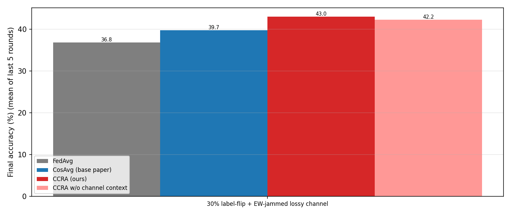
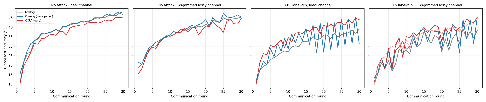
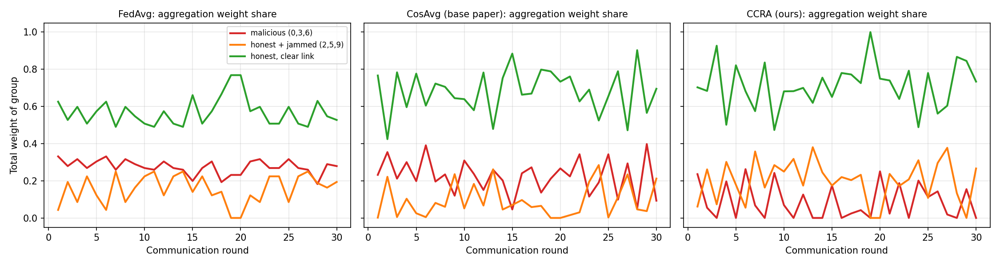

# Context-Aware Byzantine-Resilient Federated Learning for Tactical UAV Swarms

> **Result provenance:** the Month 1 and Months 2–3 numbers below are preserved
> historical results from the earlier centralized simulator. The hierarchical,
> trace-driven, multi-attack extension is implemented later in this document;
> its results must be generated with `run_experiments.py` and are not silently
> substituted into the earlier tables.

## Month 1: Foundation & Baseline (weeks 1–4)

This month's goal was a standard federated learning pipeline with **no robustness** in PyTorch,
plus a **FedAvg baseline accuracy**. Months 2–5 are measured against it.

### Setup

```powershell
cd C:\Users\Lenovo\Documents\uav-swarm-fl
pip install -r requirements.txt pyarrow pillow
python prepare_data.py        # CIFAR-10 via fast HF mirror -> data/cifar10.npz
```

The default model is **TacticalEdgeCNN** (about 156k params), which runs well on CPU.
A 50-round, 10-drone run takes about 20 min with 8 threads.
`get_device()` picks CUDA first, then Apple **MPS**, then CPU. To use a GPU, install a CUDA build of PyTorch.
The larger `--model lightcnn` (about 403k params) is about 5x slower on CPU.

### Run

```powershell
# IID baseline: 10 drones, 50 rounds, 2 local epochs
python run_baseline.py --name fedavg_iid

# Non-IID baseline: each drone covers a different "sector" with a skewed class mix
python run_baseline.py --partition dirichlet --dirichlet-alpha 0.5 --name fedavg_noniid

# Plot
python plot_results.py results/fedavg_iid results/fedavg_noniid --out results/baseline_curves.png
```

Every option in `fl/config.py` is also a CLI flag, for example `--num-clients 5 --rounds 100 --local-epochs 1 --lr 0.02`.

### Project layout

| File | Purpose |
|---|---|
| `fl/config.py` | `FLConfig` dataclass. Every field is also a CLI flag. |
| `fl/data.py` | CIFAR-10 loading, the **aerial modification**, and IID/Dirichlet partitioning across drones |
| `fl/models.py` | `TacticalEdgeCNN` (default, about 156k params, no norm layers) and `LightCNN` (about 403k params, GroupNorm) |
| `fl/client.py` | `DroneClient`: local SGD on the drone's own data. Returns a `ClientUpdate`. |
| `fl/server.py` | `FedAvg` aggregator (pluggable), evaluation, and the federated round loop with CSV/JSON logging |
| `run_baseline.py` | Entry point. Writes `results/<name>/{config,metrics.csv,history,summary,swarm_partition}.json` and the model checkpoints. |
| `plot_results.py` | Accuracy and loss curves for one or more runs |
| `prepare_data.py` | Fast CIFAR-10 download (the official server is very slow) |

### "Aerial" CIFAR-10

A nadir (downward-looking) drone camera has no fixed "up" direction, and its effective resolution depends on altitude.
`fl/data.py::aerialize` applies both effects to CIFAR-10:

* **Orientation:** each image gets a fixed random rotation of k×90°. This applies to the train set and to the test set.
* **Altitude:** each image gets a fixed random degradation. It is downsampled to 32 px (50% of images), 24 px (30%) or 16 px (20%) and then upsampled back to 32 px.
* **Training augmentation:** all 8 dihedral orientations (flips plus transpose) and a random crop with 4 px padding.

### FedAvg algorithm (per round)

1. The server broadcasts the global weights *w_t* to the selected drones (`--client-fraction`).
2. Each drone *k* runs `local_epochs` of SGD on its local data *D_k* and gets *w_t^k*.
3. The server aggregates: *w_{t+1} = Σ_k (n_k / n) · w_t^k*. Every update is trusted equally, with no filtering.

### Baseline results

| Run | Partition | Final test accuracy |
|---|---|---|
| `fedavg_iid` | IID (5,000 balanced images/drone) | **62.62%** |
| `fedavg_noniid` | Dirichlet α=0.5 | **60.23%** |

Both runs: 10 drones, 50 rounds, 2 local epochs. Details are in `results/BASELINE.md`.


Months 2–3 build on this pipeline. See below.

---

## Months 2–3: Byzantine attacks, lossy wireless channel, and CCRA vs the base paper

**Base paper:** *Unmanned Aerial Vehicle-Assisted Federated Learning Method Based on a Trusted Execution Environment*,
Electronics (MDPI) 2023, 12(18), 3938. Its aggregation method is **CosAvg** (cosine-similarity-based aggregation).

**Our method:** **CCRA**, Context-Calibrated Robust Aggregation.

### Base paper vs our work

| | Base paper: CosAvg (Electronics 2023) | **Ours: CCRA** |
|---|---|---|
| **Goal** | Secure UAV-assisted FL using a TEE plus robust aggregation | Robust UAV-swarm FL under **Byzantine attacks + EW jamming + non-IID data** |
| **Trust anchor** | TEE on the aggregator | TEE on the aggregator (same assumption), which holds a small trusted reference set |
| **Reference for "good" updates** | Mean of all received updates | Update computed on the trusted reference set inside the TEE |
| **How updates are weighted** | Cosine similarity to the mean; negative similarity dropped | Channel-calibrated cosine to the trusted reference, plus reputation memory across rounds |
| **Wireless channel** | Not modelled ? | Modelled: path loss, fading, jammer, SINR, packet loss, noise |
| **Lost packets** | Lost parameters treated as 0 (in our reimplementation) | Each parameter averaged only over drones that delivered it |
| **Honest drone with a bad link** | Looks dissimilar and gets down-weighted | Similarity is adjusted for the drone's SINR, so legitimate noise isn't punished |
| **Non-IID data** | Not addressed ? | Core part of the design. We show that cosine-to-mean breaks under non-IID. |
| **Memory across rounds** | None (each round independent) ? | Reputation (EMA). Caught attackers stay distrusted. |
| **Norm clipping** | ? | Yes (median RMS) |
| **Evaluation focus** | TEE overhead vs HE/DP, plus robustness to malicious clients | Accuracy under 4 scenarios: clean / jamming / attack / attack + jamming |
| **Accuracy under 30% label-flip + jamming** (our setup) | 39.7% | **43.0%** |
| **Attackers' weight share** (same scenario) | 21.5% | **8.4%** |
| **Cost when there is no attack** | — | About 2.5 points lower than CosAvg |

**?** means the full paper text was not accessible when this was written. Check against the paper.

### Results

Setup: aerial CIFAR-10, 10 drones with non-IID data (Dirichlet α=0.5), TacticalEdgeCNN, 30 rounds, 1 local epoch, seed 42.
The attackers are drones 0, 3 and 6, which flip their labels. The jammer targets drones 2, 5 and 9, which are honest.

**Accuracy (%), mean of the last 5 rounds:**

| Scenario | FedAvg | CosAvg (base paper) | **CCRA (ours)** |
|---|---|---|---|
| No attack, ideal channel | 46.5 | **47.1** | 44.5 |
| No attack, EW-jammed lossy channel | 44.6 | **45.6** | 43.1 |
| 30% label-flip, ideal channel | 37.6 | 36.6 | **43.3** |
| 30% label-flip + EW-jammed lossy channel | 36.8 | 39.7 | **43.0** |

**Share of aggregation weight given to the malicious drones** (mean of the last 10 rounds):

| Scenario | FedAvg | CosAvg | **CCRA** |
|---|---|---|---|
| 30% label-flip, ideal channel | 26.0% | 19.1% | **1.9%** |
| 30% label-flip + EW-jammed lossy channel | 27.5% | 21.5% | **8.4%** |





**Who gets trusted under attack and jamming.** FedAvg weights the attackers (red) as much as anyone. CosAvg keeps letting them back in and often ignores the honest jammed drones (orange). CCRA keeps the attackers near 0 most of the time, while the honest jammed drones keep contributing.



**Takeaways**
1. The label-flipping attack costs FedAvg about 10 points (46.5 → 36.8).
2. Under attack, CosAvg (the base paper) barely helps: it gets 36.6–39.7% and still gives the attackers about 20% of the weight.
3. CCRA stays at about 43–44% in every scenario. That is **+6.7 over CosAvg under attack** and **+3.3 under attack plus jamming**.
4. CCRA costs about 2.5 points when there is no attack, because it sometimes down-weights honest drones whose data is very skewed.

**Limitations (work in progress)**
- Results are from a single seed and 30 rounds. Multi-seed runs are next.
- The channel-context part of CCRA adds only +0.8 points over the no-context ablation (42.2 → 43.0), which is within noise.
- CCRA uses a 500-image trusted reference set in the TEE and CosAvg does not. Running CosAvg with the same reference is planned.
- CosAvg is our reimplementation from the paper's description.

### What was added
| File | What it does |
|---|---|
| `fl/channel.py` | Lossy wireless uplink. Includes drone positions and mobility, log-distance path loss, Rayleigh fading, a ground EW jammer, SINR, a logistic PER curve, per-packet erasures (1,024 params/packet), and residual noise ∝ 10^(−SINR/20). Each drone reports SINR, PER and PDR telemetry. |
| `fl/client.py` | `make_malicious()` implements a label-flipping attack (c → 9−c, e.g. airplane ↔ truck). |
| `fl/aggregators.py` | `FedAvg`, `CosAvg` (base paper), `CCRA` (ours), and `ccra_noctx` (an ablation without the channel context). |
| `run_experiments.py` | Runs the full comparison matrix in parallel. |
| `plot_compare.py` | Produces the accuracy curves, the final-accuracy bars, the weight-share plot and `RESULTS.md`. |

### Fair comparison
Every run uses the same seed, Dirichlet α=0.5 non-IID split, initial weights, malicious drones (0, 3, 6), jammer position (over drones 2, 5, 9), per-round channel realisation, model and hyperparameters.
**Only the aggregation rule changes.**

### CCRA in one paragraph
The aggregator's TEE (the same trust anchor the base paper assumes) holds a small clean reference set of 50 images/class. Each round, CCRA does the following:

1. Computes a trusted reference update from that set.
2. Scores each drone by the cosine between its update and the reference. The cosine is computed only over packets that actually arrived, and calibrated for the expected noise at that drone's reported SINR.
3. Turns the score into a reputation that persists across rounds, and excludes drones whose reputation falls below 0.3.
4. Clips each update's norm.
5. Averages each parameter only over the drones that delivered it.

FedAvg and CosAvg instead treat lost packets as zeros, which dilutes every update.

### Key observation that motivates CCRA
Under non-IID data, cosine similarity to the *mean or median* update (the CosAvg reference) does **not** separate attackers from honest drones that simply hold unusual data. In our diagnostics, the attackers' cosine (0.1–0.2) overlapped with that of honest-but-skewed drones. Cosine to a *trusted reference update* was negative for the attackers in every round.

### Run
```powershell
python run_experiments.py --profile legacy --out-dir results/compare  # original 13-run matrix
python plot_compare.py           # figures + results/compare/RESULTS.md
```

---

## Guide-requested extension: mobility, HFL, measured channels, and Byzantine benchmarks

### Hierarchical federation and handover

`--topology hierarchical` creates multiple ground base stations. Each UAV trains
from its serving BS model, each BS performs intra-cell aggregation, and the edge
models are sample-weighted into a global model every `--global-sync-every`
rounds. The synchronized model is then broadcast to all BSs. Association uses
received power; a new cell must exceed the serving cell by
`--handover-hysteresis-db` for `--handover-ttt` consecutive rounds. Client
identity and CCRA reputation survive handover.

```bash
python run_baseline.py \
  --name hfl_label_ccra \
  --topology hierarchical --num-base-stations 3 --global-sync-every 5 \
  --channel lossy --jammed-ids 2,5,9 \
  --attack label_flip --malicious-ids 0,3,6 \
  --aggregator ccra --partition dirichlet
```

Every round records serving cells, handovers, per-cell participants, edge/global
synchronization, PDR, latency, staleness, honest rejection, attacker acceptance,
and effective malicious aggregation weight.

### DeepSense 6G Scenario 23 traces

[DeepSense 6G Scenario 23](https://www.deepsense6g.net/scenarios/Scenarios%2020-29/scenario-23)
is the measurement source selected for the UAV link. It contains synchronized
60 GHz beam-power vectors, GPS, altitude, distance, speed, pitch, and roll from
a mobile drone and one stationary BS. Download access requires a DeepSense
account; the raw archive is deliberately excluded from Git.

Prepare and use it as follows:

```bash
python scripts/prepare_deepsense23.py /path/to/Scenario23 \
  --out data/channel_traces/deepsense23.npz

python run_baseline.py \
  --name hfl_trace_ccra \
  --topology hierarchical --num-base-stations 3 \
  --channel trace --channel-trace-path data/channel_traces/deepsense23.npz \
  --aggregator ccra --attack sign_flip --malicious-ids 0,3,6
```

The importer stores the maximum measured beam-power value and its source sample
index. If the downloaded release needs an absolute-power calibration, apply an
explicit offset with `--power-offset-db` during preparation or
`--trace-rx-power-offset-db` at runtime; do not silently assume units.

Scenario 23 is a **single-BS measurement**, so it does not directly contain
multi-cell handovers. For additional simulated BSs, received power is adjusted
from the measured reference using relative 3-D distance and the configured
path-loss exponent. `assumptions.json` records this limitation. Packet errors,
jamming, Shannon-rate upload latency, deadline misses, and staleness are derived
or simulated rather than claimed as measurements from DeepSense.

### Attacks and defenses

Available attacks:

| CLI name | Type | Behavior |
|---|---|---|
| `label_flip` | Data poisoning | Maps label `c` to `9-c` before local training |
| `sign_flip` | Model poisoning | Sends `-attack_scale × delta` |
| `gaussian` | Model poisoning | Sends deterministic seeded Gaussian noise scaled to honest-update RMS |
| `alie` | Model poisoning | Shifts within the honest coordinate-wise mean/standard-deviation envelope |
| `ipm` | Model poisoning | Sends a vector opposite the honest mean direction |

ALIE and IPM intentionally model a strong attacker that observes honest updates
inside its serving cell. This assumption is written to `assumptions.json`.

Available aggregators are `fedavg`, `cosavg`, `median`, `trimmed_mean`, `krum`,
`multi_krum`, `fltrust`, `ccra`, and `ccra_noctx`. FLTrust and both CCRA variants
use the same clean 500-image root dataset. Krum's effective Byzantine count is
limited by the number of updates received in a cell; cells with fewer than three
updates use a recorded FedAvg fallback.

CCRA treats poor delivery, recent handover, and low historical link reliability
as *weak evidence*, not evidence of maliciousness. These factors slow reputation
changes, while gradient direction against the trusted root remains the behavioral
signal. Stale updates are separately down-weighted.

### Reproducible evaluation

```bash
# Two-round interface and compatibility check
python run_experiments.py --profile smoke --parallel 2

# Multi-seed benchmark
python run_experiments.py \
  --profile core --seeds 41 42 43 --rounds 30 --parallel 2

# Include measurement-driven channel scenarios
python run_experiments.py \
  --profile core --seeds 41 42 43 \
  --trace-path data/channel_traces/deepsense23.npz

python analyze_benchmark.py results/benchmark
python plot_benchmark.py results/benchmark
```

The analyzer produces `benchmark_summary.csv` and `BENCHMARK_SUMMARY.md` with
mean and sample standard deviation across completed seeds. Full benchmark output
is ignored by Git until results have been reviewed and deliberately selected for
publication.

### New implementation files

| File | Purpose |
|---|---|
| `fl/topology.py` | Base-station layout, UAV positions, association, hysteresis, and handover state |
| `fl/channel_traces.py` | Validated compact trace loader with source-sample provenance |
| `scripts/prepare_deepsense23.py` | Scenario 23 preprocessing without redistributing raw data |
| `fl/attacks.py` | Label/model poisoning definitions and explicit attacker assumptions |
| `fl/aggregators.py` | Statistical, Krum-family, FLTrust, CosAvg, and CCRA defenses |
| `fl/server.py` | Intra-cell aggregation, inter-cell synchronization, telemetry, and metrics |
| `run_experiments.py` | Resumable clean/attack × channel × defense experiment matrix |
| `analyze_benchmark.py` | Multi-seed mean/standard-deviation report |
| `plot_benchmark.py` | Accuracy heatmap and honest-rejection/attacker-acceptance trade-off plot |
